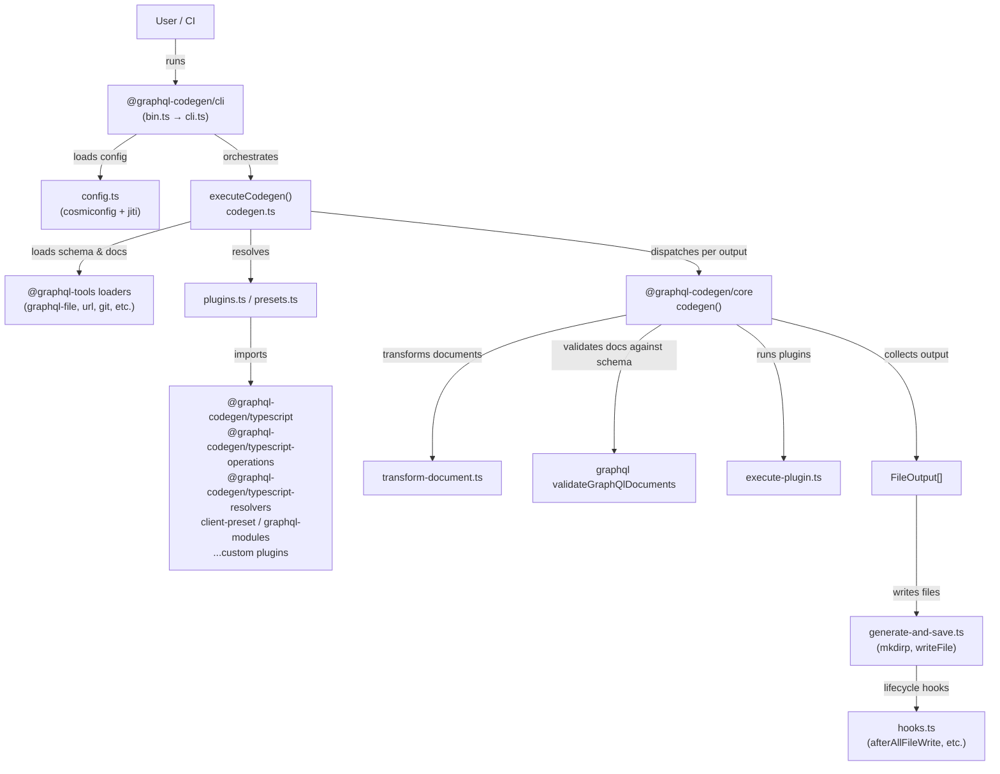

# GraphQL Code Generator — Architecture

## System Overview

GraphQL Code Generator is a Yarn-workspace monorepo that reads a codegen configuration file, loads a GraphQL schema and (optionally) operation documents, then dispatches them through a chain of plugins and presets to produce strongly-typed output files (TypeScript types, resolver stubs, typed document nodes, and more). The CLI (`graphql-codegen`) is the user-facing entry point; the `@graphql-codegen/core` engine handles schema merging, document validation, caching, and plugin/preset dispatch. All packages publish dual ESM + CJS builds via `bob-the-bundler`.

## Architecture Diagram

## Component Map

| Package / Directory | Responsibility | Key Dependencies |
|---------------------|---------------|------------------|
| `packages/graphql-codegen-cli/` | CLI orchestration: config loading, watch mode, Listr task runner, schema/document loading | `core`, `plugin-helpers`, `@graphql-tools/*`, cosmiconfig, listr2, yargs |
| `packages/graphql-codegen-core/` | Engine: schema merge, doc validation, document transforms, plugin dispatch, output assembly | `plugin-helpers`, `@graphql-tools/schema` |
| `packages/utils/plugins-helpers/` | Shared `Types` namespace, `CodegenPlugin` interface, `Profiler`, federation helpers | graphql |
| `packages/utils/graphql-codegen-testing/` | Test utilities shared across packages | — |
| `packages/plugins/typescript/typescript/` | Emits TypeScript scalar/enum/interface/union types | `visitor-plugin-common` |
| `packages/plugins/typescript/operations/` | Emits typed operation/fragment interfaces | `visitor-plugin-common` |
| `packages/plugins/typescript/resolvers/` | Emits resolver type stubs | `visitor-plugin-common` |
| `packages/plugins/typescript/typed-document-node/` | Emits `TypedDocumentNode` wrappers | `visitor-plugin-common` |
| `packages/plugins/typescript/gql-tag-operations/` | Emits typed `gql` tag helpers | `visitor-plugin-common` |
| `packages/plugins/other/visitor-plugin-common/` | Shared AST visitor base classes used by all TypeScript plugins | graphql |
| `packages/plugins/other/add/` | Injects raw content into output files | — |
| `packages/plugins/other/introspection/` | Emits JSON introspection result | — |
| `packages/plugins/other/schema-ast/` | Emits schema SDL | — |
| `packages/presets/client/` | High-level client preset (combines typescript + operations + gql-tag-operations) | multiple plugins |
| `packages/presets/graphql-modules/` | Emits per-module TypeScript types for GraphQL Modules | `visitor-plugin-common` |
| `packages/presets/swc-plugin/` | Rust/WASM SWC transform for `gql` tag detection | Rust, wasm32-wasi |
| `packages/graphql-cli-codegen-plugin/` | GraphQL CLI integration | `cli` |
| `dev-test/` | Integration fixtures — generated output tracked in git | — |
| `examples/` | End-to-end example projects with tracked generated output | — |
| `website/` | Next.js documentation site | Next.js, Nextra, Tailwind |
| `scripts/` | Build helpers (fix-bin, match-graphql, print-example-ci-command) | — |

## Request Flow (Codegen Run)

1. User runs `graphql-codegen` (or calls `generate()` programmatically)
2. `cli.ts` parses CLI flags via yargs; `config.ts` loads `codegen.yml/ts/json` via cosmiconfig + jiti
3. `executeCodegen()` in `codegen.ts` builds a shared in-memory cache keyed by `namespace:key`
4. For each output path in `generates`, it loads the schema (once, cached) and documents (once per set)
5. Presets expand each output entry into one or more `Types.GenerateOptions` objects
6. `@graphql-codegen/core`'s `codegen()` merges schemas, runs document transforms, validates documents against the schema, then dispatches each plugin via `execute-plugin.ts`
7. Plugin outputs (strings + prepend/append blocks) are assembled into a single file content string
8. `generate-and-save.ts` writes output files (creating directories as needed), skipping unchanged files (content hash comparison), and removes stale files in watch mode
9. Lifecycle hooks (`afterAllFileWrite`, etc.) fire after all files are written

## Key Design Decisions

### Dual ESM + CJS Output
All packages publish both `dist/esm/` and `dist/cjs/` via `bob-the-bundler`. This supports Node.js environments that require CJS as well as modern bundlers that prefer ESM. Import paths inside `src/` use `.js` extensions (not `.ts`) so they resolve correctly in both output formats.

### Plugin/Preset System
Code generation is fully modular. Plugins implement `(schema, documents, config) => string | PluginOutput` and can inject prepend/append content. Presets expand a single output spec into multiple `GenerateOptions` objects (e.g., the `client` preset generates multiple files). This separation keeps the core engine generic.

### Performance Profiling Built-In
The `Profiler` interface (in `plugin-helpers`) wraps every expensive operation (`codegen()`, `validateDuplicateDocuments`, per-plugin execution) in named timing events. `--profile` flag emits a Chrome Trace JSON file. New performance-sensitive paths must use `profiler.run(fn, 'label')`.

### Schema and Document Caching
`createCache()` (in `cli/codegen.ts`) de-duplicates schema loading and document validation across output files in a single run. The cache key includes a SHA-256 schema hash (stored in `schema.extensions.hash`) and document content hashes, so stale cache entries are never used.

### Config Format Flexibility
cosmiconfig with custom loaders supports `codegen.yml`, `codegen.yaml`, `codegen.json`, `codegen.js`, `codegen.ts`, and `package.json#codegen`. YAML files support environment variable interpolation via `string-env-interpolation`.

## External Dependencies

| Service / Tool | Protocol / Mechanism | Location | Purpose |
|----------------|---------------------|----------|---------|
| `@graphql-tools/*` loaders | File I/O / HTTP / git | `cli/src/load.ts` | Schema and document loading from files, URLs, git, GitHub, Prisma |
| `cosmiconfig` | File I/O | `cli/src/config.ts` | Config file discovery |
| `jiti` | Node.js `require` hook | `cli/src/config.ts` | TypeScript config file execution |
| `listr2` | Node.js | `cli/src/codegen.ts` | Parallel task display |
| `@parcel/watcher` (optional) | File system events | `cli/src/utils/watcher.ts` | Watch mode |
| `bob-the-bundler` | Build tool | root `package.json` | Dual ESM/CJS packaging |
| Changesets | CLI | `.changeset/` | Versioning and changelog |

## Cross-Cutting Concerns

### Configuration
All runtime config flows through the `CodegenContext` class (`cli/src/config.ts`). Access via `context.getConfig()`. Plugins receive their slice of config as the third argument — never access global state or env vars directly inside a plugin.

### Error Handling
Errors from plugins bubble up through `execute-plugin.ts`. Schema/document validation errors are collected and thrown as multi-error messages. Config loading errors include the file path in the message. The `noSilentErrors` config option prevents silent swallowing of errors.

### Testing
Tests live in `packages/**/tests/` and use `babel-jest` for TS transform. Shared setup is in `dev-test/setup.js`. Snapshot format uses unescaped strings. After any change to plugin output, regenerate and commit `dev-test/` and `examples/` diffs.
